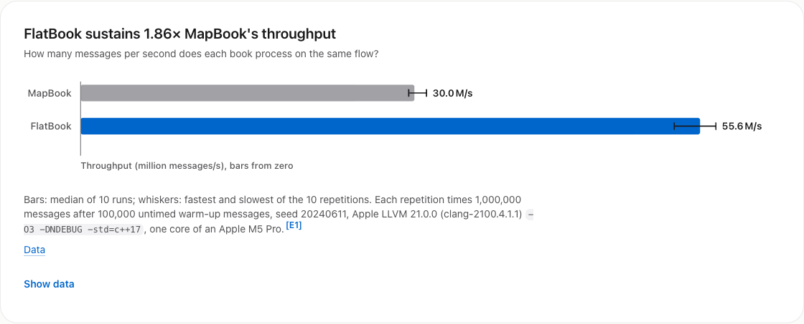

# limitorderbook

A limit order book matching engine in C++17, built twice: `MapBook` on `std::map`, and `FlatBook` on flat arrays, so their speed can be compared on the same order flow.

**[Read the report →](https://allenwang0.github.io/limitorderbook/)** results, method, limits and every number's source.



## Highlights

<!-- results:start -->
| Book | Messages/s | Time per message |
| :--- | ---: | ---: |
| MapBook | 30.0M | 33 ns |
| FlatBook | 55.6M | 18 ns |

FlatBook: **1.86×** MapBook's throughput. Median of 10 runs, one thread on Apple M5 Pro, seeded synthetic flow (55% add, 40% cancel, 5% market).
<!-- results:end -->

- **Checked op by op** against a simple reference book: 20 seeds of 100,000 random operations, also under AddressSanitizer and UndefinedBehaviorSanitizer.
- **Limit, market, IOC, fill-or-kill and post-only orders**; cancel is designed for average O(1).

## Run it

```sh
git clone https://github.com/allenwang0/limitorderbook.git
cd limitorderbook
cmake --workflow --preset default    # Release build + tests
scripts/run_bench.sh                 # 10 repetitions; rebuilds the report from results/
./build/lob_replay examples/demo_flow.txt
cmake --workflow --preset asan       # Debug build with ASan + UBSan
```

Needs CMake 3.25+, Ninja and a C++17 compiler.

## How it works

- Prices are integer ticks. Orders match best price first, then oldest first, and every fill trades at the resting order's price.
- `MapBook` keeps price levels in a `std::map` and each level's orders in a linked list.
- `FlatBook` keeps orders in a pooled array linked by index, and price levels for a fixed 4,096-tick window in a vector indexed by tick; prices outside it fall back to a `std::map`.
- Reducing an order's size keeps its place in the queue; raising it or changing its price sends it to the back.
- `lob_replay` turns a file of order commands into JSON fills and book depth.

## Limitations

- One instrument, one thread, no networking or market data feed.
- The benchmark flow is synthetic, and the window is centred on its prices.
- Single operations are faster than the clock's tick, so per-message latencies are coarse; throughput is the measure that separates the books.
- Heap allocations are not measured.
