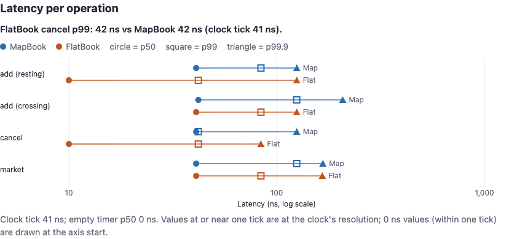
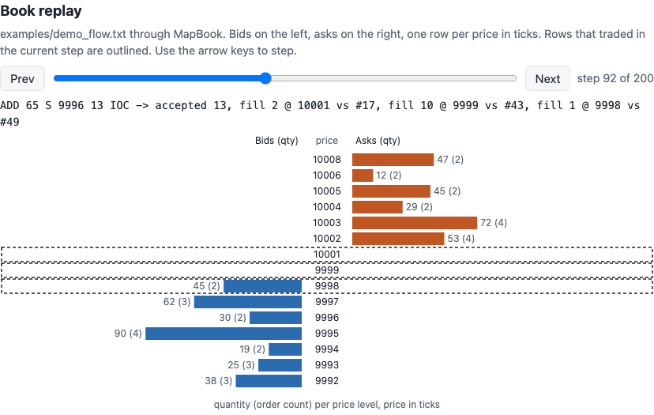

# limitorderbook

A single-instrument limit order book in C++17 with price-time priority, O(1) cancel, market, IOC, FOK and post-only orders, two book implementations checked against a naive reference, and per-operation latency percentiles.





CI rebuilds the report on every push to `main` and publishes it to GitHub Pages at https://allenwang0.github.io/limitorderbook/. It has the latency and throughput charts and a step-through replay of `examples/demo_flow.txt`. All order flow on it is seeded and synthetic.

## Design

Prices are integer ticks (`int64_t`), quantities and ids are `uint64_t`. A book takes an `EventSink` and reports every outcome to it as an `Event`: `Accepted`, `Fill`, `Cancelled` or `Rejected`. The book keeps no trade log of its own.

Matching is price-time priority. An incoming order trades against the best opposite level first and, within a level, against the oldest order first. Every fill trades at the resting order's price.

Order types (`OrderType`):

| Type | Behaviour |
| :--- | :--- |
| `Limit` | Matches up to its price, then rests the remainder. |
| `Market` | Matches at any price and never rests; the remainder is cancelled. Its price is ignored. |
| `ImmediateOrCancel` | Matches up to its price; the remainder is cancelled. |
| `FillOrKill` | Sums opposite liquidity up to its price first. If that covers the whole quantity it matches; otherwise it is cancelled with no fills. |
| `PostOnly` | Rejected with `WouldCross` if it would trade on arrival; otherwise rests. |

`addOrder` rejects a zero quantity, a price of zero or less on any non-market order, and an id that is already resting. `cancelOrder` and `modifyOrder` reject unknown ids.

`modifyOrder(id, newQuantity, newPrice)` follows the CME and Nasdaq rule. A size reduction at the same price changes the order in place and keeps its queue position. A size increase or a price change removes the order and adds it again as a `Limit` order at the back of its new level, so it loses priority and can trade if the new price crosses.

There are two implementations with the same interface:

- `MapBook` keeps levels in a `std::map` and the orders at each level in a `std::list`. An `unordered_map` from id to (side, level iterator, list iterator) makes cancel a direct unlink. `lob_replay` and the example use this book.
- `FlatBook` keeps orders in a pooled array linked by index, so resting an order after warm-up does not allocate. Levels inside a 4,096-tick window are a vector indexed by tick offset, with a `std::map` for prices outside it. The best price per side is cached. The id index is an open-addressing hash table that allocates only when it grows.

Complexity, with L price levels on a side, k levels crossed by an incoming order and g empty ticks between a level that empties and the next one:

| Operation | MapBook | FlatBook |
| :--- | :--- | :--- |
| Add, resting | O(log L) | O(1) in the window, O(log L) outside it |
| Add, crossing | O(log L + k + fills) | O(k + fills + g) |
| Cancel | O(1) average | O(1) average, plus O(g) if it empties the best level |
| Modify, size reduction | O(1) average | O(1) average |
| Best bid / ask | O(1) | O(1) |
| depth(side, n) | O(n) | O(n + g) |
| volumeAtPrice | O(log L) | O(1) in the window, O(log L) outside it |

## Build and test

Requires CMake 3.25+, Ninja and a C++17 compiler. GoogleTest v1.15.2 and Google Benchmark v1.9.1 come in through FetchContent.

```sh
git clone https://github.com/allenwang0/limitorderbook.git
cd limitorderbook
cmake --workflow --preset default
```

That configures a Release build in `build/`, builds the library, tests, `lob_bench`, `lob_replay` and `examples/basic.cpp`, and runs ctest. The sanitizer build runs the same tests in Debug with AddressSanitizer and UndefinedBehaviorSanitizer:

```sh
cmake --workflow --preset asan
```

Run the tools:

```sh
./build/lob_bench
./build/lob_replay examples/demo_flow.txt
```

`lob_replay` reads `ADD <id> <B|S> <price> <qty> [LIMIT|MARKET|IOC|FOK|POST]`, `CXL <id>` and `MOD <id> <qty> <price>` lines from a file or stdin. It writes one JSON line per command with the events it produced and `depth(10)` of both sides afterwards.

The report page, card and results table below come from one script:

```sh
python3 -m venv .venv && .venv/bin/pip install -r requirements-dev.txt
PATH=$PWD/.venv/bin:$PATH scripts/run_bench.sh
```

It runs `lob_bench` and `lob_replay`, then writes `results/bench.json`, `results/replay.jsonl`, `docs/index.html`, `site/card.json` and the table in this README.

## Usage

`examples/basic.cpp`, built and run by ctest:

```cpp
#include "lob/MapBook.h"

#include <iostream>

using namespace lob;

struct PrintFills : EventSink {
    void onEvent(const Event& event) override {
        if (event.type == EventType::Fill) {
            std::cout << "fill: order " << event.orderId << " bought " << event.quantity << " @ "
                      << event.price << " from order " << event.restingId << '\n';
        }
    }
};

int main() {
    PrintFills sink;
    MapBook book(sink);

    book.addOrder({1, Side::Sell, 10'050, 100});
    book.addOrder({2, Side::Sell, 10'060, 200});
    book.addOrder({3, Side::Buy, 10'000, 150});
    book.addOrder({4, Side::Buy, 10'055, 120});
    book.cancelOrder(3);

    for (const LevelInfo& level : book.depth(Side::Sell, 5)) {
        std::cout << "ask " << level.price << ": " << level.quantity << " in " << level.orderCount
                  << " order(s)\n";
    }
    std::cout << "best bid: " << book.bestBid().value_or(0) << '\n';
}
```

Output:

```text
fill: order 4 bought 100 @ 10050 from order 1
ask 10060: 200 in 1 order(s)
best bid: 10055
```

## Results

`lob_bench` builds one seeded message stream: 55% add, 40% cancel and 5% market. Add prices sit a geometric number of ticks from the touch (mean 3 ticks) and 10% of adds are priced through it. Each book first processes 100,000 warm-up messages untimed, then each of the next 1,000,000 is timed on its own with `steady_clock`. Adds are counted as resting or crossing depending on whether they produced fills.

<!-- results:start -->
Measured on Apple M5 Pro with Apple LLVM 21.0.0 (clang-2100.4.1.1), flags `-O3 -DNDEBUG -std=c++17`, commit `346f4def2791`, 2026-11-11. Seeded synthetic flow (55% add, 40% cancel, 5% market, seed 20240611), 1,000,000 timed messages after 100,000 warm-up messages.

| Book | Operation | Samples | p50 | p90 | p99 | p99.9 | max |
| :--- | :--- | ---: | ---: | ---: | ---: | ---: | ---: |
| MapBook | add (resting) | 497,470 | 41 | 42 | 84 | 125 | 17,500 |
| MapBook | add (crossing) | 54,410 | 42 | 83 | 125 | 208 | 17,917 |
| MapBook | cancel | 398,175 | 41 | 42 | 42 | 125 | 18,583 |
| MapBook | market | 49,945 | 41 | 42 | 125 | 167 | 8,792 |
| FlatBook | add (resting) | 497,470 | 0 | 42 | 42 | 125 | 16,542 |
| FlatBook | add (crossing) | 54,410 | 41 | 42 | 84 | 125 | 20,250 |
| FlatBook | cancel | 398,175 | 0 | 42 | 42 | 84 | 11,958 |
| FlatBook | market | 49,945 | 41 | 42 | 84 | 166 | 1,625 |

Latencies in ns. Throughput on the same flow, without per-message timing:

| Book | Messages/s |
| :--- | ---: |
| MapBook | 31.15M |
| FlatBook | 58.95M |

The steady_clock tick on this machine is 41 ns and an empty timer pair has a p50 of 0 ns, so any percentile at or near one tick is at the clock's resolution, not a measured cost, and 0 means the operation started and finished within one tick. Throughput gives the mean cost per message without that limit.
<!-- results:end -->

## Testing

- Unit tests (GoogleTest) run once per book. They cover arrival-order fills at one price, partial fills keeping priority, a sweep across levels at each resting price, every rejection reason, cancel and modify, and each order type.
- The differential test drives `MapBook`, `FlatBook` and a `FlatBook` with a 16-tick window against `NaiveBook`, a reference that keeps every order in one vector and finds the best price by linear scan. A seeded generator issues adds of every type, cancels, modifies and market orders, including zero quantities, bad prices, duplicate ids and unknown ids. After every op the test requires the same result, the same events, the same `depth(10)` on both sides, the same top of book and order count, and each book's own invariants: no crossed book, level totals equal to the sum of their orders, and every indexed id resting where the index says. It runs 20 seeds of 100,000 ops each, in Release and under ASan and UBSan.
- `lob_replay` has a golden-output test and a malformed-input test, and the report has unit tests for the card and its empty and error states, plus a Playwright check at 375px and 1280px in light and dark.

## Limitations

- One instrument, one thread, integer ticks.
- No networking, persistence or market data feed.
- All benchmark and replay flow is seeded and synthetic. The plan's LOBSTER sample replay is not implemented.
- The clock limits the latency numbers. Percentiles at or near one clock tick are at the clock's resolution, so use the throughput figures for typical cost.

## License

MIT. See [LICENSE](LICENSE).
