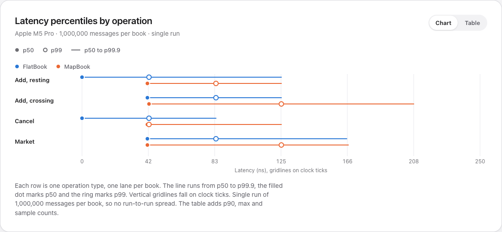
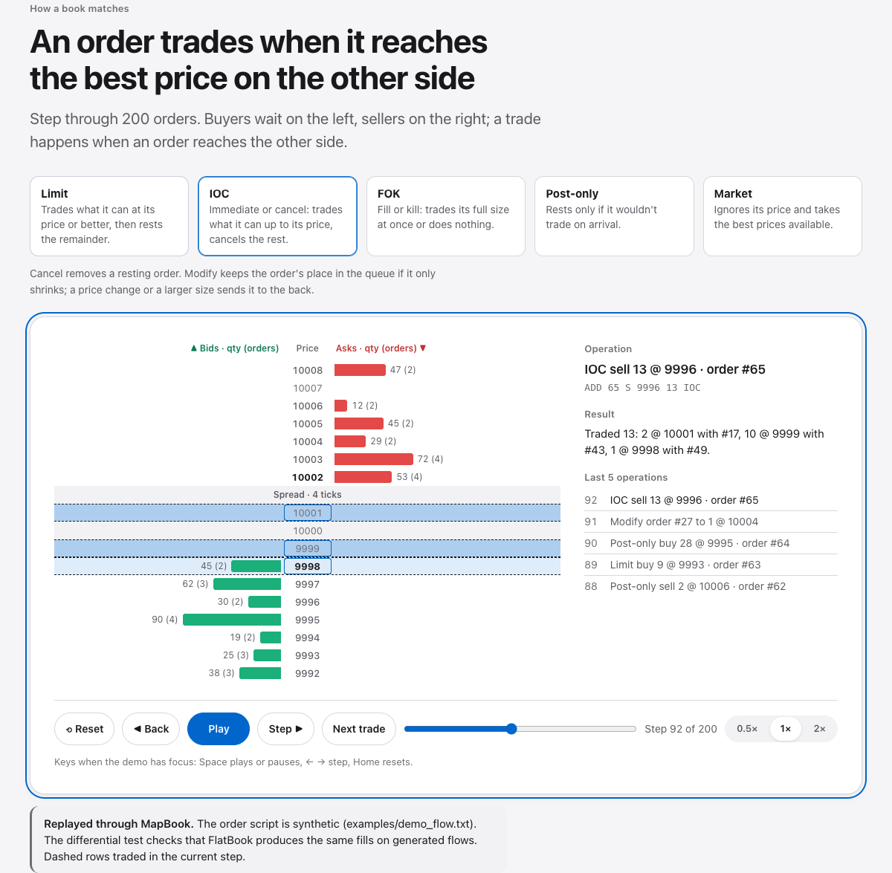

# limitorderbook

A limit order book matching engine in C++17. It has two interchangeable implementations: a straightforward `std::map` book and a cache-friendly flat book that runs about 1.9x faster. Both are checked op by op against a naive reference book.



## Highlights

- **58.95M messages/s** for `FlatBook` on a seeded add/cancel/market stream (Apple M5 Pro), against 31.15M for `MapBook`.
- **Differential testing**: both books and a small-window `FlatBook` are compared with a linear-scan reference after every op, across 20 seeds of 100,000 ops each, in Release and under ASan and UBSan.
- **Market, IOC, fill-or-kill and post-only orders** alongside plain limit orders, with price-time priority and O(1) average cancel.
- **Allocation-free resting orders** in `FlatBook` after warm-up: orders live in a pooled array linked by index, price levels in a tick-indexed window, and the id index is an open-addressing hash table that allocates only when it grows.
- **Exchange-style modify**: a size reduction keeps queue priority; a size increase or price change goes to the back of the queue, following the CME and Nasdaq rule.

## Quickstart

Requires CMake 3.25+, Ninja and a C++17 compiler. GoogleTest and Google Benchmark are fetched automatically.

```sh
git clone https://github.com/allenwang0/limitorderbook.git
cd limitorderbook
cmake --workflow --preset default    # Release build + tests
./build/lob_bench                    # latency and throughput benchmark
./build/lob_replay examples/demo_flow.txt
```

`cmake --workflow --preset asan` runs the same tests in Debug with AddressSanitizer and UndefinedBehaviorSanitizer.

## Usage

From `examples/basic.cpp`, which ctest builds and runs:

```cpp
#include "lob/MapBook.h"

#include <iostream>

using namespace lob;

struct PrintFills : EventSink {
    void onEvent(const Event& event) override {
        if (event.type == EventType::Fill) {
            std::cout << "fill: order " << event.orderId << " bought " << event.quantity << " @ "
                      << event.price << " from order " << event.restingId << '\n';
        }
    }
};

int main() {
    PrintFills sink;
    MapBook book(sink);

    book.addOrder({1, Side::Sell, 10'050, 100});
    book.addOrder({2, Side::Sell, 10'060, 200});
    book.addOrder({3, Side::Buy, 10'000, 150});
    book.addOrder({4, Side::Buy, 10'055, 120});
    book.cancelOrder(3);

    for (const LevelInfo& level : book.depth(Side::Sell, 5)) {
        std::cout << "ask " << level.price << ": " << level.quantity << " in " << level.orderCount
                  << " order(s)\n";
    }
    std::cout << "best bid: " << book.bestBid().value_or(0) << '\n';
}
```

```text
fill: order 4 bought 100 @ 10050 from order 1
ask 10060: 200 in 1 order(s)
best bid: 10055
```

## Design

Prices are integer ticks (`int64_t`); quantities and ids are `uint64_t`. A book reports every outcome to an `EventSink` as an `Event` (`Accepted`, `Fill`, `Cancelled` or `Rejected`) and keeps no trade log of its own.

Matching is price-time priority: an incoming order trades against the best opposite level first and, within a level, the oldest order first. Every fill trades at the resting order's price.

| Order type | Behaviour |
| :--- | :--- |
| `Limit` | Matches up to its price, then rests the remainder. |
| `Market` | Matches at any price and never rests; the remainder is cancelled. |
| `ImmediateOrCancel` | Matches up to its price; the remainder is cancelled. |
| `FillOrKill` | Checks opposite liquidity up to its price first. Fills completely or is cancelled with no fills. |
| `PostOnly` | Rejected with `WouldCross` if it would trade on arrival; otherwise rests. |

**`MapBook`** keeps levels in a `std::map` and each level's orders in a `std::list`. An `unordered_map` from id to (side, level iterator, list iterator) makes cancel a direct unlink.

**`FlatBook`** keeps orders in a pooled array linked by index. Levels inside a 4,096-tick window are a vector indexed by tick offset, with a `std::map` for prices outside it, and the best price per side is cached.

Complexity, with L price levels on a side, k levels crossed by an incoming order and g empty ticks between a level that empties and the next one:

| Operation | MapBook | FlatBook |
| :--- | :--- | :--- |
| Add, resting | O(log L) | O(1) in the window, O(log L) outside it |
| Add, crossing | O(log L + k + fills) | O(k + fills + g) |
| Cancel | O(1) average | O(1) average, plus O(g) if it empties the best level |
| Modify, size reduction | O(1) average | O(1) average |
| Best bid / ask | O(1) | O(1) |
| depth(side, n) | O(n) | O(n + g) |
| volumeAtPrice | O(log L) | O(1) in the window, O(log L) outside it |

## Results

`lob_bench` builds one seeded message stream: 55% add, 40% cancel and 5% market. 90% of adds rest 1 + Geometric(0.25) ticks behind the opposite best price (4 ticks on average); the other 10% are priced at or through it. Each book processes 100,000 untimed warm-up messages, then each of the next 1,000,000 is timed individually with `steady_clock`. Adds count as resting or crossing depending on whether they produced fills.

<!-- results:start -->
Measured on Apple M5 Pro with Apple LLVM 21.0.0 (clang-2100.4.1.1), flags `-O3 -DNDEBUG -std=c++17`, commit `346f4def2791`, 2026-11-11. Seeded synthetic flow (55% add, 40% cancel, 5% market, seed 20240611), 1,000,000 timed messages after 100,000 warm-up messages.

| Book | Operation | Samples | p50 | p90 | p99 | p99.9 | max |
| :--- | :--- | ---: | ---: | ---: | ---: | ---: | ---: |
| MapBook | add (resting) | 497,470 | 41 | 42 | 84 | 125 | 17,500 |
| MapBook | add (crossing) | 54,410 | 42 | 83 | 125 | 208 | 17,917 |
| MapBook | cancel | 398,175 | 41 | 42 | 42 | 125 | 18,583 |
| MapBook | market | 49,945 | 41 | 42 | 125 | 167 | 8,792 |
| FlatBook | add (resting) | 497,470 | 0 | 42 | 42 | 125 | 16,542 |
| FlatBook | add (crossing) | 54,410 | 41 | 42 | 84 | 125 | 20,250 |
| FlatBook | cancel | 398,175 | 0 | 42 | 42 | 84 | 11,958 |
| FlatBook | market | 49,945 | 41 | 42 | 84 | 166 | 1,625 |

Latencies in ns. Throughput on the same flow, without per-message timing:

| Book | Messages/s |
| :--- | ---: |
| MapBook | 31.15M |
| FlatBook | 58.95M |

The steady_clock tick on this machine is 41 ns and an empty timer pair has a p50 of 0 ns, so any percentile at or near one tick is at the clock's resolution, not a measured cost, and 0 means the operation started and finished within one tick. Throughput gives the mean cost per message without that limit.
<!-- results:end -->

`scripts/run_bench.sh` regenerates this table, `results/bench.json` and the HTML report in `docs/index.html` (latency charts plus a step-through depth-ladder replay of `examples/demo_flow.txt`).



## Replay tool

`lob_replay` reads `ADD <id> <B|S> <price> <qty> [LIMIT|MARKET|IOC|FOK|POST]`, `CXL <id>` and `MOD <id> <qty> <price>` lines from a file or stdin, and writes one JSON line per command with the resulting events and `depth(10)` of both sides.

## Testing

- **Unit tests** (GoogleTest) run against both books and cover priority, partial fills, multi-level sweeps, every rejection reason (zero quantity, bad price, duplicate or unknown id), modify and each order type.
- **Differential test**: `MapBook`, `FlatBook` and a `FlatBook` with a 16-tick window (to force the out-of-window path) run against `NaiveBook`, a linear-scan reference, on seeded flow that includes invalid input (zero quantities, bad prices, duplicate and unknown ids). After every op they must agree on the result, events, `depth(10)`, top of book and order count, and pass their own invariants: no crossed book, level totals that match their orders, and an id index that points where each order actually rests.
- `lob_replay` has golden-output and malformed-input tests.

## Limitations

- One instrument, one thread, integer ticks. No networking, persistence or market data feed.
- Benchmark flow is seeded and synthetic, not replayed market data.
- Per-message latencies are limited by the 41 ns clock tick; the throughput numbers are the better measure of typical cost.

## License

MIT. See [LICENSE](LICENSE).
